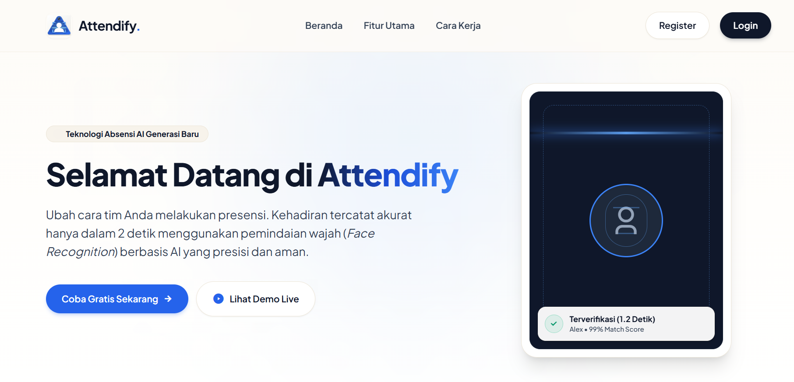

<div align="center">

  <!-- Logo -->
  

# 🚀 Attendify

**Sistem Presensi Cerdas Berbasis Face Recognition AI**

_Solusi presensi kantor yang cepat, akurat, bebas sentuh, dan anti-manipulasi._

[](https://codeigniter.com/)
[](https://www.php.net/)
[](https://www.mysql.com/)
[](https://www.sqlite.org/)
[](https://tailwindcss.com/)
[](https://github.com/justadudewhohacks/face-api.js)
[](LICENSE)

> **Preview Produk**
> 

</div>

---

## 📌 Latar Belakang & Tujuan Proyek

Presensi karyawan adalah fondasi pengelolaan sumber daya manusia di setiap perusahaan. Namun, metode konvensional yang masih banyak digunakan—mesin **fingerprint**, kartu ID, atau **pencatatan manual**—terus menghadirkan masalah operasional yang sama dari tahun ke tahun:

| Masalah Lama | Dampak Nyata |
|---|---|
| 🖐️ Mesin sidik jari sering gagal baca | Antrean panjang di pintu masuk, karyawan terlambat |
| 📋 Pencatatan manual & absen titip | Data tidak akurat, rawan manipulasi & kecurangan |
| 🗂️ Rekapitulasi memakan waktu HR | HR menghabiskan berjam-jam hanya untuk merekap absensi |
| 🏠 Tidak mendukung remote / hybrid | Tidak ada solusi presensi yang fleksibel dan terverifikasi |
| 📵 Tidak ada visibilitas real-time | Manajer tidak bisa memonitor kehadiran secara langsung |

**Attendify hadir sebagai jawaban modern atas permasalahan tersebut.**

Attendify adalah sistem manajemen presensi karyawan berbasis **Kecerdasan Buatan (AI)** yang memanfaatkan teknologi **Face Recognition** untuk memastikan setiap proses absensi terjadi dengan cepat, terverifikasi secara biometrik, dan terdokumentasi secara otomatis — semua langsung dari **browser**, tanpa hardware khusus.

> **Tujuan Utama:** Mendigitalisasi, mengautomatisasi, dan mengamankan seluruh siklus presensi karyawan — dari clock-in pagi hingga laporan HR bulanan.

---

## ✨ Fitur Unggulan yang Siap Diadopsi Perusahaan

### 🔍 1. Presensi via Face Recognition (Tanpa Sentuh)
Karyawan cukup membuka browser, arahkan kamera ke wajah, dan sistem secara otomatis memverifikasi identitas dalam **< 2 detik**. Tidak perlu PIN, kartu, atau antri di depan mesin. Ideal untuk lingkungan kantor modern, ruang rapat, maupun area resepsionis.

### 📍 2. Validasi Geofencing GPS
Sistem memverifikasi lokasi GPS karyawan saat melakukan presensi. Hanya karyawan yang berada dalam radius yang telah ditentukan (contoh: 100 meter dari kantor) yang diperbolehkan melakukan clock-in. Mencegah presensi palsu dari lokasi yang tidak sah.

### 🕐 3. Manajemen Shift Kerja Fleksibel
Admin dapat mendefinisikan beberapa jenis shift (Pagi, Siang, Malam, dsb.) lengkap dengan jam masuk, jam pulang, dan toleransi keterlambatan. Sistem secara otomatis menghitung status **Hadir / Terlambat / Absen** berdasarkan jadwal yang aktif.

### 👁️ 4. Live Attendance Monitor (Real-Time)
Dashboard admin menyediakan tampilan presensi karyawan secara **langsung dan real-time** — siapa sudah masuk, siapa terlambat, dan siapa belum hadir — tanpa perlu refresh halaman. Memberi visibilitas penuh bagi manajer operasional dan HR.

### 📊 5. Dashboard Laporan & Rekap Otomatis
Semua data presensi terakumulasi secara otomatis ke dalam laporan yang terstruktur. Admin dan HR dapat memfilter laporan berdasarkan rentang tanggal, departemen, atau individu karyawan — siap untuk keperluan penggajian dan audit SDM.

### 🌿 6. Manajemen Cuti & Izin Digital
Karyawan dapat mengajukan permohonan cuti atau izin langsung dari portal mereka, dilengkapi keterangan dan jenis cuti. Admin atau HR dapat menyetujui atau menolak pengajuan tersebut dengan satu klik, dan statusnya langsung dapat dilihat oleh karyawan secara transparan.

### 🔐 7. Role-Based Access Control (RBAC)
Sistem memiliki dua peran yang terpisah secara ketat:
- **Admin/HR** — Akses penuh ke seluruh manajemen, laporan, dan konfigurasi sistem.
- **Karyawan** — Hanya dapat mengakses portal presensi, profil, riwayat, dan pengajuan izin milik sendiri.

### 🧬 8. Pendaftaran Biometrik Self-Service
Karyawan baru dapat mendaftarkan data wajah mereka sendiri langsung dari browser melalui halaman *Face Enrollment* yang dipandu. Data biometrik disimpan sebagai **128-dimensi face descriptor vector** (bukan foto), menjaga privasi karyawan tetap aman.

### 📱 9. Fully Responsive — Akses dari Mana Saja
Seluruh tampilan dibangun dengan **Tailwind CSS** dan dioptimalkan untuk semua ukuran layar: desktop, tablet, dan smartphone. Karyawan dapat melakukan presensi dari perangkat apapun tanpa perlu menginstal aplikasi.

---

## 🏗️ Arsitektur & Tech Stack

```
┌─────────────────────────────────────────────────────────────────┐
│                        ATTENDIFY SYSTEM                         │
├─────────────────────┬───────────────────────────────────────────┤
│   FRONTEND LAYER    │            BACKEND LAYER                  │
│                     │                                           │
│  • Tailwind CSS     │  • CodeIgniter 4.7.5 (MVC Framework)     │
│  • face-api.js      │  • PHP 8.1+ (OOP, Type Hints)            │
│    (TensorFlow.js)  │  • MySQL 8.0+ / SQLite3 (fallback)       │
│  • Remix Icon       │  • REST API Endpoints (JSON)             │
│  • Plus Jakarta     │  • Session-based Authentication          │
│    Sans (Google     │  • Role-Based Filter Middleware           │
│    Fonts)           │  • Haversine Geofence Library            │
│                     │  • Euclidean Biometric Matcher           │
└─────────────────────┴───────────────────────────────────────────┘
```

### Stack Detail

| Layer | Teknologi | Versi | Fungsi |
|---|---|---|---|
| **Backend Framework** | CodeIgniter 4 | 4.7.5 | MVC, Routing, Filters, ORM |
| **Language** | PHP | 8.1+ | Server-side logic |
| **Database Utama** | MySQL | 8.0+ | Production data store |
| **Database Fallback** | SQLite3 | Built-in PHP | Development / lightweight deploy |
| **AI Biometrik** | face-api.js | TensorFlow.js | Face detection & 128-d descriptor extraction |
| **Styling** | Tailwind CSS | 3.x | Utility-first CSS, responsive design |
| **Icon Library** | Remix Icon | CDN | UI iconography |
| **Typography** | Plus Jakarta Sans | Google Fonts | Modern, clean font system |
| **Build Tool** | GNU Make | 4.x | Task automation (serve, migrate, test) |
| **Testing** | PHPUnit | via CI4 | Unit & feature testing |

---

## 🗂️ Struktur Halaman & Modul

```
Attendify/
├── 🌐 PUBLIC
│   ├── /                      → Landing Page (Beranda)
│   └── /login                 → Halaman Login
│
├── 👤 PORTAL KARYAWAN (Auth required)
│   ├── /employee/dashboard    → Dashboard ringkasan karyawan
│   ├── /employee/profile      → Profil & edit data pribadi
│   ├── /employee/leaves       → Riwayat & pengajuan cuti/izin
│   ├── /employee/face-enrollment → Pendaftaran biometrik wajah
│   ├── /attendance/scan       → Halaman presensi (Face Scan)
│   └── /attendance/history    → Riwayat kehadiran pribadi
│
└── 🔑 PANEL ADMIN/HR (Role: admin required)
    ├── /admin/dashboard       → Executive summary dashboard
    ├── /admin/attendance/live → Live attendance monitor
    ├── /admin/employees       → Manajemen data karyawan (CRUD)
    ├── /admin/leaves          → Approval cuti & izin
    ├── /admin/shifts          → Konfigurasi shift kerja
    ├── /admin/geofence        → Pengaturan radius GPS kantor
    └── /admin/reports         → Laporan kehadiran & rekap HR
```

---

## 🚀 Panduan Instalasi & Penggunaan

### Prasyarat

- PHP `>= 8.1` dengan ekstensi: `intl`, `mbstring`, `json`, `sqlite3` atau `mysqlnd`
- Composer
- GNU Make (opsional, untuk kemudahan perintah)
- MySQL 8.0+ (opsional; sistem akan otomatis menggunakan SQLite jika MySQL tidak tersedia)

### Langkah Instalasi

```bash
# 1. Clone repositori
git clone https://github.com/rachmanz/attendify.git
cd attendify

# 2. Install dependensi PHP
composer install

# 3. Salin file environment
cp app/.env.example app/.env

# 4. Konfigurasi database di app/.env (opsional jika menggunakan SQLite)
# DB_HOSTNAME=127.0.0.1
# DB_PORT=3306
# DB_DATABASE=attendify
# DB_USERNAME=root
# DB_PASSWORD=

# 5. Jalankan setup database (migrasi + seeding akun awal)
make setup

# 6. Jalankan server pengembangan
make serve
```

Akses aplikasi di: **`http://localhost:8080`**

### Akun Default (Setelah Seeding)

| Role | Email | Password |
|---|---|---|
| 🔑 Admin/HR | `admin@attendify.com` | `password123` |
| 👤 Karyawan | `karyawan@attendify.com` | `password123` |

> ⚠️ **Penting:** Ganti password default sebelum deploy ke production!

---

## 🛠️ Perintah Makefile

```bash
make help          # Tampilkan panduan semua perintah
make serve         # 🚀 Jalankan server → http://localhost:8080
make setup         # 🎉 Migrate + Seed (setup pertama kali)
make migrate       # 📦 Jalankan migrasi database
make seed          # 🌱 Isi data akun awal
make routes        # 🗺️ Tampilkan semua endpoint HTTP
make test          # 🧪 Jalankan unit tests (PHPUnit)
make stop          # 🛑 Matikan server
make clean         # 🧹 Bersihkan cache sistem
make docker-up     # 🐳 Nyalakan MySQL via Docker
make docker-down   # 🛑 Matikan container Docker
```

---

## 🔐 Keamanan

Attendify dirancang dengan mempertimbangkan keamanan data sejak awal:

- ✅ **Session-Based Authentication** — Token sesi terenkripsi untuk setiap pengguna
- ✅ **Role-Based Access Control** — Filter middleware memblokir akses tidak sah per peran
- ✅ **Password Hashing** — Semua password di-hash menggunakan `bcrypt` via PHP `password_hash()`
- ✅ **Geofence Validation** — Presensi hanya diterima dari koordinat GPS yang valid
- ✅ **Biometric Privacy** — Wajah tidak disimpan sebagai foto; hanya 128-d descriptor vector numerik
- 🔲 **CSRF Protection** — Tersedia, siap diaktifkan untuk environment production
- 🔲 **HTTPS Enforcement** — `force_https` tersedia di konfigurasi CI4

---

## 🗺️ Peta Jalan Pengembangan (Roadmap)

Attendify dibangun dengan fondasi yang kuat dan dirancang untuk berkembang. Berikut adalah arah pengembangan ke depan:

### ✅ Fase A — Fondasi & Autentikasi (Selesai)
- [x] Sistem login/logout dengan session management
- [x] Role-based access control (Admin vs Karyawan)
- [x] Struktur database relasional lengkap
- [x] Migrasi & seeding data awal

### ✅ Fase B — Portal Karyawan & Presensi (Selesai)
- [x] Dashboard karyawan dengan ringkasan statistik
- [x] Presensi via Face Recognition (browser-based)
- [x] Pendaftaran biometrik wajah (Self-service enrollment)
- [x] Riwayat kehadiran pribadi
- [x] Pengajuan & tracking cuti/izin digital
- [x] Validasi geofencing GPS

### ✅ Fase C — Panel Admin & Manajemen HR (Selesai)
- [x] Executive dashboard dengan statistik ringkasan
- [x] Live attendance monitor real-time
- [x] Manajemen data karyawan (CRUD lengkap)
- [x] Approval cuti & izin
- [x] Konfigurasi shift kerja & kebijakan
- [x] Pengaturan geofence & radius kantor
- [x] Laporan kehadiran & rekap HR

### 🔮 Fase D — Integrasi & Peningkatan (Mendatang)
- [ ] **Export Excel/PDF** — Ekspor laporan kehadiran langsung dari dashboard
- [ ] **Notifikasi Email** — Pemberitahuan otomatis saat cuti disetujui/ditolak
- [ ] **Multi-lokasi Kantor** — Dukungan beberapa titik geofence untuk cabang berbeda
- [ ] **Integrasi Payroll** — Koneksi data kehadiran ke sistem penggajian
- [ ] **Mobile App (PWA)** — Progressive Web App untuk pengalaman mobile native
- [ ] **Anti-Spoofing** — Deteksi liveness untuk mencegah penggunaan foto/video
- [ ] **Laporan Analitik Lanjutan** — Tren kehadiran, prediktif absensi, heat map
- [ ] **SSO / LDAP Integration** — Single sign-on untuk enterprise dengan Active Directory
- [ ] **Rate Limiting** — Throttler pada endpoint login & API presensi
- [ ] **Audit Log** — Pencatatan seluruh aktivitas admin untuk keperluan audit internal

---

## 💡 Visi & Harapan Ke Depan

> _"Attendify bukan sekadar sistem absensi. Ini adalah fondasi digital menuju manajemen SDM yang lebih cerdas, transparan, dan manusiawi."_

Kami percaya bahwa teknologi harus memudahkan, bukan memperumit. Dalam jangka panjang, Attendify diharapkan dapat:

1. **Menjadi standar presensi digital** bagi perusahaan menengah dan besar di Indonesia yang ingin meninggalkan metode konvensional.
2. **Mendukung budaya kerja hybrid** dengan validasi kehadiran yang fleksibel namun tetap terverifikasi dan aman.
3. **Memberdayakan tim HR** dengan data kehadiran yang akurat, real-time, dan siap pakai — mengurangi beban administratif secara signifikan.
4. **Menjadi platform terbuka** yang dapat diintegrasikan dengan sistem ERP, HRD, dan payroll yang sudah ada di perusahaan.
5. **Evolusi ke AI yang lebih dalam** — mulai dari deteksi mood/kelelahan karyawan, analitik produktivitas, hingga prediksi risiko turnover berbasis pola kehadiran.

---

## 🤝 Kontribusi

Kontribusi sangat terbuka! Jika Anda menemukan bug, memiliki ide fitur, atau ingin berkontribusi pada pengembangan:

1. Fork repositori ini
2. Buat branch fitur baru: `git checkout -b feat/nama-fitur`
3. Commit perubahan Anda: `git commit -m "feat: tambah fitur X"`
4. Push ke branch: `git push origin feat/nama-fitur`
5. Buka Pull Request

---

## 📄 Lisensi

Proyek ini dilisensikan di bawah **MIT License** — bebas digunakan, dimodifikasi, dan didistribusikan dengan tetap mencantumkan atribusi.

Lihat file [LICENSE](LICENSE) untuk detail lengkap.

---

<div align="center">

**Dibangun dengan ❤️ oleh [RahmanDevs](https://github.com/rachmanz)**

_Transformasi digital presensi dimulai dari sini._

[](https://github.com/rachmanz)

</div>
